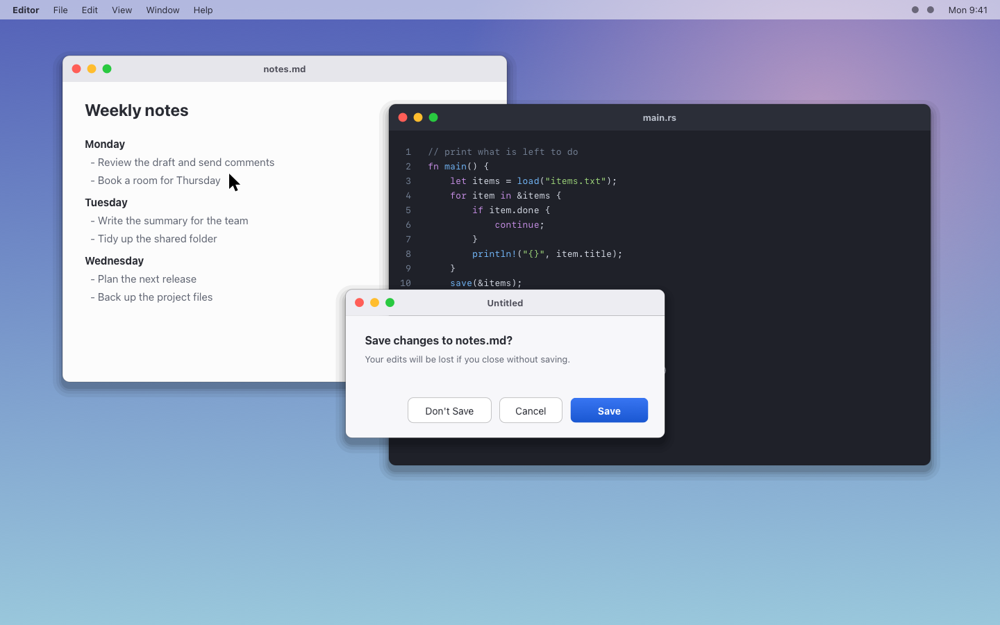
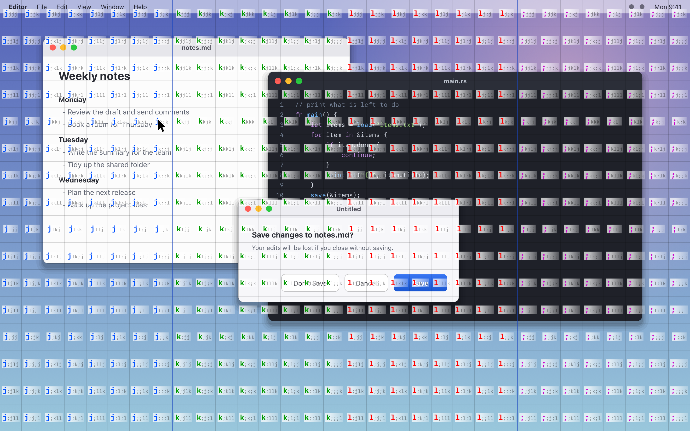
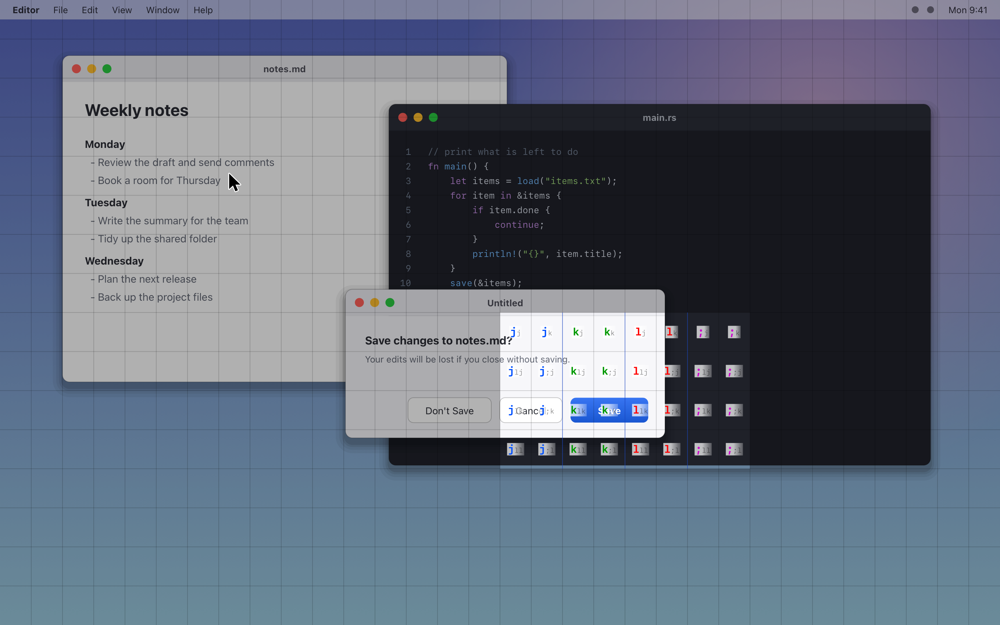
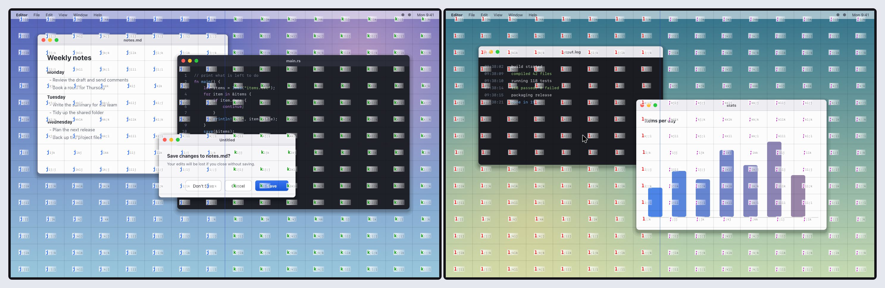
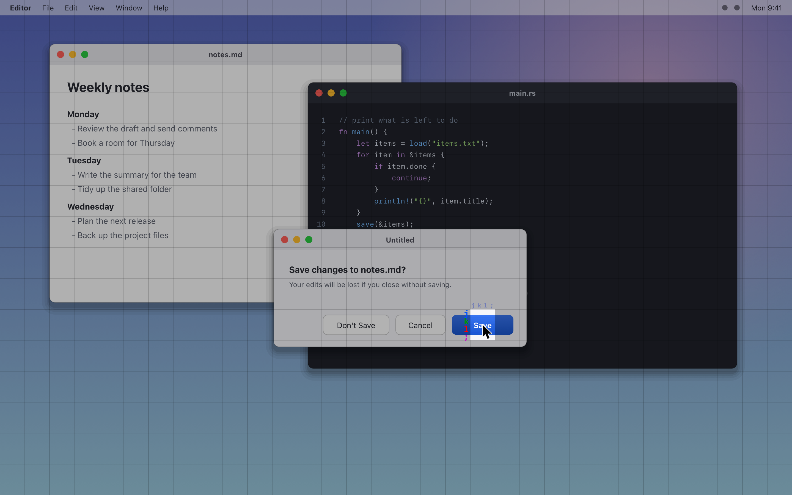

<h1 align="center">unmouse</h1>

<p align="center"><b>キーボードだけで macOS のマウスポインタを動かします。</b></p>

[English](README.md) | 日本語

unmouse は macOS 用の小さな常駐ツールです。右 Command を2回タップすると、全モニターの全セルに `j` `k` `l` `;` だけのラベルが出ます。行きたい場所のラベルを打つと、ポインタがそのセルの中心へ動きます。クリックはマウスやトラックパッドで行うか、キーで行います。

ホームポジションから手を離したくない人や、ボタンやリンクや画面の隅へキーボードだけで行きたい人向けです。

## 画面の例



*起動した直後です。全セルにラベルが出て、次に打つ文字は大きく色付きで表示されます。*



*2文字打った後です。一致する範囲だけが残り、その中のセルが細かくなります。*



*2台のモニターは1枚の画面です。境目をまたぐセルは、面積の大きい側のモニターにラベルを出します。*

## クイックスタート

**必要なもの**: Apple Silicon か Intel の macOS（リリースのバイナリは universal です）。macOS 15.6 で確かめています。

> [!IMPORTANT]
> 許可を与える前にお読みください。
>
> - unmouse には Accessibility（環境によっては入力監視 / Input Monitoring も）の許可が必要です。起動の操作を見つけるため、また画面を出している間に打ったキーを飲み込むため、すべてのキーイベントを見ています。
> - 打った内容は記録も送信もしません。ネットワークに関わる依存はありません（`Cargo.toml` を見てください）。ソースもここにあります。
> - `unmouse run --verbose` が出すのは、unmouse 自身が使ったキーだけです。ほかのアプリへ通したキーは、コードも出さずに `keyDown passthrough` とだけ出ます。

1. **インストールする。**

   ```sh
   curl -fsSL https://raw.githubusercontent.com/Asugawara/unmouse/main/install.sh | sh
   ```

   リリースをダウンロードしてチェックサム（`SHA256SUMS`）を確かめ、バイナリを `~/.local/bin/unmouse` に置きます。続けて `unmouse install` を実行し、バイナリをコピーして署名し、ログイン項目に登録します。

2. **許可する。** 初回の起動で Accessibility の許可を求められます。システム設定 > プライバシーとセキュリティ > アクセシビリティ で `unmouse` を許可してください。許可したあとに動き出さなければ、`unmouse restart` を打ってください。

3. **使ってみる。** 右 Command を2回タップして、画面上の場所のラベルを打ちます。左 Command など別の操作で起動したいときは、[設定](#設定)の `hotkey` で変えられます。

4. **確かめる。** `unmouse doctor` で、権限・イベントタップ・Secure Input・設定・モニターを確かめられます。

## できること

**ホームポジションのキーだけ。** ラベルは `j` `k` `l` `;` だけでできています。次に打つ文字は大きく色付き（青・緑・赤・マゼンタ）なので、今どこを打っているか分かります。

**全モニターを1枚の画面として扱う。** モニターを選ぶ段はありません。全モニターに一度にラベルが出ます。

**キーでクリックする、動かすだけにする。** ラベルを打つと、ポインタがセルの中心へ動きます。打ちかけで `Space` `d` `s` `a` を押すと、その範囲の中心で左クリック・右クリック・ダブルクリック・中クリックします。`g` はドラッグの開始と終了です。ポインタを動かしたあとに、マウスやトラックパッドでクリックしても構いません。

**`refine` でさらに細かく狙う。** `refine = true` にすると、ラベルを打ち終えても閉じず、セルの縁に細分のキーを出します。続けて `j` `k` `l` `;` で絞り、`Space` などでクリックします。



*`refine = true` のときです。セルが決まったあとも、`j` `k` `l` `;` で細かく絞れます。*

**見た目を変えられる。** ラベルの大きさ、配置、色、太さ、背景の不透明度を設定ファイルで変えられます。

## キー

| キー | 動作 |
|---|---|
| `j` `k` `l` `;` | ラベルを打つ（`refine = true` のときは、セルが決まった後も細分のキーとして使う） |
| `Space` / `d` / `s` / `a` | 左クリック / 右クリック / ダブルクリック / 中クリックして終了 |
| `f` | クリックせずに、その範囲の中心へカーソルだけ動かして閉じる（打ちかけのときの、起動の操作と同じ） |
| `g` | ドラッグの開始と終了 |
| `h` か `Backspace` | 1文字戻る |
| `Esc` | 取り消す |
| 起動の操作をもう一度（既定は右 Cmd の2回タップ） | 閉じる（打ちかけなら、その範囲の中心へ動かす。ドラッグ中は取り消す） |

操作キーは `[actions]` で変えられます。起動中は、表にないキーを押しても何も起きず、ほかのアプリにも届きません。画面にキーの案内は出ないので、この表で確かめてください。

## 設定

設定ファイルは `~/.config/unmouse/config.toml` です。`$XDG_CONFIG_HOME` が設定されていれば、その下の `unmouse/config.toml` を読みます。ファイルがなければ既定値で動きます。設定は起動時に読むので、変えたら `unmouse restart` を打ってください。

全項目は `config.example.toml` を参照してください。よく変える項目は次のとおりです。

- `hotkey`: 起動の操作（既定 `"double:right_cmd"`）。トップレベルに書きます。修飾キーの2回タップは `"double:right_cmd"`（ほかに `left_cmd` `right_option` `left_option` `right_shift` `left_shift` `right_ctrl` `left_ctrl`）、キーの組み合わせは `"ctrl+alt+j"` の形で書きます。左 Command の2回タップにするなら `hotkey = "double:left_cmd"` です。
- `double_tap_ms`: 2回タップの間隔と、1回の押下の上限（ms、100〜1000、既定 300）。トップレベルに書きます。2回のタップの間にキーを押すか、マウスを動かす・クリックする・スクロールすると、数え直します（Karabiner などで右 Cmd を押したままマウスを操作しても起動しません）。
- `label_size`: ラベルの文字サイズ（pt、6〜48）。`[style]` に書きます。
- `label_layout`: `"center"`（既定）はセルの真ん中に1まとまりで出します。`"inline"` はセルの左上に出します。`"corners"` は4隅に1文字ずつ出します（4文字のときだけ。それ以外は `"center"` と同じ）。`[style]` に書きます。
- `key_colors`: 次に打つ文字の色（`"#rrggbb"` を4つ、`grid.keys` と同じ順）。既定は `j` 青、`k` 緑、`l` 赤、`;` マゼンタです。次に打つ文字は太字で（太さは `next_weight` で変えられます）、キーごとの色になります。`[style]` に書きます。
- `next_scale`: 次に打つ文字（色が付いている文字）の大きさの倍率。既定は `1.5`、`1.0`〜`3.0` で指定します。大きい文字と小さい文字はベースラインをそろえて描きます。細分のキー（`refine = true`）も次に打つものだけ同じ倍率になります。`[style]` に書きます。
- `next_weight`: 次に打つ文字の太さ。`"regular"` / `"semibold"` / `"bold"` / `"heavy"` / `"black"` から選びます。既定は `"bold"`。`font` に名前を指定していると効きません。`[style]` に書きます。
- `label_bg_opacity` / `label_bg_end_opacity`: ラベルの白い背景の不透明度。先頭の文字までは `label_bg_opacity`（既定 `0.72`）で、右端の `label_bg_end_opacity`（既定 `0.25`）へ向けて薄くなります。同じ値にすると一様になります。背景の上下は、いちばん大きい文字の上端と下端に合わせます。`[style]` に書きます。
- `max_cell`: 1つのセルの最大サイズ（pt、`[width, height]`）。大きいほどセルが粗くなります。`[grid]` に書きます。
- `subdivide`: セルの分け方。`"half"`（既定）は、4文字で決まる枠ごとに、左の列の上下2セルを5文字、残りの6セルを6文字にします（5文字目の `l` は上の段、`;` は下の段）。2台（3840×1080）では 1024 セルで、5文字と6文字が混ざります。`"off"` は一様に分け、2台で 512 セル（すべて5文字）です。`"quarter"` は4等分の段を1つ足し、2048 セル（すべて6文字）です。`[grid]` に書きます。
- `scope`: `"all_monitors"`（既定）は全モニターを1枚の画面として扱います。`"cursor_monitor"` はカーソルのあるモニターだけで分けます。`[grid]` に書きます。
- `refine`: `false`（既定）は、ラベルを打ち終えると閉じます。`true` は閉じずに細分のキーを出し、続けて `j` `k` `l` `;` で細かく絞れます。その間は `Space` `d` `s` `a` で、その位置をキーでクリックできます。`[grid]` に書きます。

## 対応と制限

- **macOS 専用です。** リリースのバイナリは universal（Apple Silicon と Intel）です。macOS 15.6 で確かめています。
- **Secure Input 中は起動しません。** パスワード欄にフォーカスがあるあいだ、macOS はキーイベントをほかのアプリへ見せません。`unmouse doctor` で Secure Input が有効かどうか分かります。
- **更新のたびに許可が要ります。** リリースのバイナリは ad-hoc 署名なので、更新すると macOS が許可をもう一度求めます。アクセシビリティの許可リストから古い `unmouse` を消して、追加し直してください。自分の署名用の証明書（`UNMOUSE_SIGN_IDENTITY`）でビルドすれば、再許可は要りません。
- **launchd はシェルの環境変数を引き継ぎません。** シェルで設定した `XDG_CONFIG_HOME` は、ログイン項目からは見えません。設定は `~/.config/unmouse/config.toml` に置いてください。
- **`kill` で止めても戻りません。** クラッシュしたときだけ自動で再起動します。
- **CLI のメッセージと `--help` は、今のところ日本語です。**

## 詳細

### 仕組み

イベントタップでキーイベントを見ています。起動の操作を受けると、モニターごとにアクティブにならないパネルを1枚ずつ出してグリッドを描くので、使っていたアプリのフォーカスは動きません。画面を出している間は、使うキーを飲み込み、それ以外は無視します。ポインタの移動とクリックは CGEvent で送ります。グリッドとラベルの計算は、システムに触れない純粋なコードです。ネットワークには何も送りません。

### 自動起動（常駐）

`unmouse install` は、実行ファイルを `~/Library/Application Support/unmouse/unmouse` にコピーして署名し、ログイン項目に登録します。以後はログインのたびに自動で起動します。`install` の前に、手動で動かしている `unmouse run` を止めてください。古いビルドはロックを持たず、二重になります。

- 止めてしまったら `unmouse restart`、やめるなら `unmouse uninstall` です。
- ビルドし直したときは `install` をもう一度打ちます。`restart` では新しいビルドに替わりません。
- 権限の許可の対象は、ターミナルではなく、コピーされたバイナリ自身です。初回は許可ダイアログが出ます。許可したあとに動き出さなければ、`unmouse restart` を打ってください（許可待ちのプロセスは、許可に気づかないことがあります）。
- `UNMOUSE_SIGN_IDENTITY` を指定しないと ad-hoc 署名になり、`cargo build` でバイナリの中身が変わると、`install` し直したときに許可が外れます（中身が同じなら外れません）。外れたら、システム設定の許可リストから古い `unmouse` を消して追加し直してください。自己署名証明書を作って `UNMOUSE_SIGN_IDENTITY` に指定すると、再許可が要らなくなります。
- ログは `~/Library/Logs/unmouse.log` に出ます。

### サブコマンド

引数なしで起動すると `run`（常駐）になります。

| コマンド | 内容 |
|---|---|
| `unmouse run [--verbose]` | 常駐して、起動の操作で起動する（既定）。起動時に権限・tap・起動の操作を標準エラーに出します。`--verbose` で受けたキーイベントを1行ずつ出します |
| `unmouse run --wait-for-permission` | 許可が出るまで待ってから常駐する。自動起動はこの形で動きます |
| `unmouse install` | 実行ファイルをコピーして署名し、ログイン時に自動で起動するよう登録する |
| `unmouse uninstall` | 自動起動の登録を外し、コピーした実行ファイルを消す（ログは残す） |
| `unmouse restart` | 登録済みの常駐を起動し直す |
| `unmouse doctor` | 権限・イベントタップ・Secure Input・設定・モニターを確かめる |
| `unmouse layout` | モニター、文字数、各モニターのセルの大きさを表示する |
| `unmouse cursor` | 今のカーソル位置を表示する |
| `unmouse path <x> <y>` | 指定した点のラベルを表示する |
| `unmouse demo --keys "<キー列>" [--delay-ms <ms>] [--allow-click]` | イベントタップなしで起動し、キーを順に流す。例: `--keys "l l k ; f"`。クリック系のキー（`space d s a g`）は既定で拒否され、`--allow-click` を付けたときだけ通ります |

### インストールのオプション

`install.sh` は次の環境変数を読みます。

| 環境変数 | 内容 |
|---|---|
| `UNMOUSE_VERSION` | 入れる版（既定: 最新のリリース） |
| `UNMOUSE_BIN_DIR` | バイナリを置く場所（既定: `$HOME/.local/bin`） |
| `UNMOUSE_BASE_URL` | リリースの URL（既定: `https://github.com/Asugawara/unmouse/releases`） |
| `UNMOUSE_NO_SERVICE=1` | バイナリだけ入れて、`unmouse install` は実行しない |

同じ版がすでに入っていれば、ダウンロードは省きます。`~/.local/bin` が `PATH` になければ、追加の方法を表示します。

### ソースからビルドする

Rust 1.89 以上が必要です。

```sh
cargo build --release
target/release/unmouse install
```

`.app` にまとめる場合は `scripts/bundle.sh` を実行します。`target/release/bundle/Unmouse.app` ができます。自分の署名で署名するには `UNMOUSE_SIGN_IDENTITY` を指定します。指定しないと ad-hoc 署名（`-`）になります。

### 更新

インストーラをもう一度実行します。macOS が許可をもう一度求めたら、許可し直してください（「対応と制限」を見てください）。

### アンインストール

`unmouse uninstall` を実行してから、`rm ~/.local/bin/unmouse` を実行します。設定（`~/.config/unmouse/config.toml`）とログ（`~/Library/Logs/unmouse.log`）は残るので、要らなければ手で消してください。

### Doctor

うまく動かないときは `unmouse doctor` を実行してください。Accessibility が許可されているか、イベントタップを作れるか、Secure Input が有効か、設定を読めるか、見つかったモニターを表示します。

## 開発

```sh
cargo build
cargo test
cargo clippy --all-targets -- -D warnings
```

スクリーンショットは撮るのではなく生成します。本物のオーバーレイの描画コードを、作り物のデスクトップと作り物のモニターと既定の設定の上で動かすので、手元の画面は何も写りません。

```sh
cargo run --release --example screenshots -- --out docs/images
```

`screenshots` ワークフローは、`src/`、`examples/`、`Cargo.lock` に触れる `main` への push で画像を作り直します（手で動かすなら `gh workflow run screenshots`）。画像が変わったときは `docs: update screenshots` のプルリクエストを開きます。

リリースの流れ:

- `main` への Conventional Commits で、release-please がリリース PR を開きます。
- その PR をマージすると、タグとドラフトのリリースができます。
- release ワークフローは、そのコミットの `ci` が通るのを待ちます。
- そのあと `unmouse-<version>-macos-universal.tar.gz` と `SHA256SUMS` をビルドします。
- 最後にそれらをアップロードして、リリースを公開します。

リリース用のファイルを手元で作るには、`sh scripts/build-release.sh <version> out` を実行します。

## ライセンス

MIT です。[LICENSE](LICENSE) を見てください。
